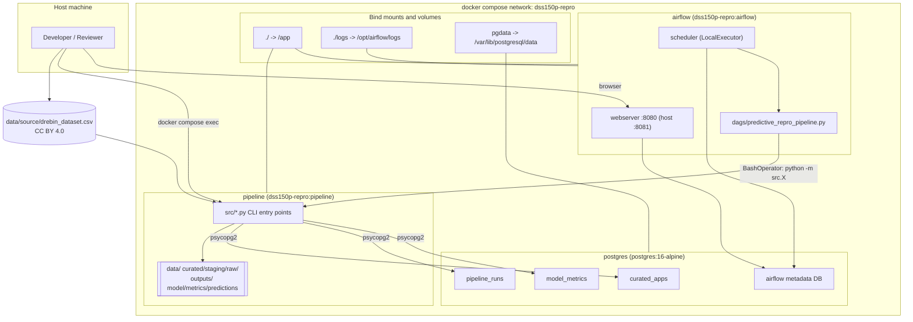

# Architecture

Software components and how they are wired together.

Notes:

- Every task in the DAG invokes a `python -m src.X` command inside the **pipeline** container, so orchestration and execution use the same image.
- PostgreSQL serves two roles: the pipeline data store (`curated_apps`, `pipeline_runs`, `model_metrics`) and the Airflow metadata store (separate `airflow` database in the same instance).
- All pipeline artifacts land under bind mounts, so they appear on the host filesystem immediately.