# Data Lineage

Dataset-level flow. Every node is a data artifact, every edge is a
transformation or a movement between layers.

```mermaid
flowchart LR
    SRC["data/source/drebin_dataset.csv<br/>15036 rows x 216 cols<br/>sha256 710f2c11...3ad5"]

    RAW["data/raw/batches/batch_0000..0002.parquet<br/>15036 rows x 223 cols<br/>+ pipeline_run_id, ingested_at_utc,<br/>source_file, source_checksum,<br/>source_row_number, source_row_key,<br/>record_hash"]

    STG["data/staging/staging.parquet<br/>15036 rows x 226 cols<br/>SimCountryIso -> {0,1},<br/>all features int64,<br/>+ transform_run_id, processed_at_utc,<br/>flag_conflicting_label (402 True)"]

    CUR["data/curated/curated.parquet<br/>15036 rows x 222 cols<br/>class -> is_malware {0,1},<br/>215 features + 6 audit cols"]

    SPLIT["metadata/split_manifest.json<br/>seed 246112165, test_size 0.2<br/>train 12028 / test 3008<br/>per-split sha256 of source_row_key"]

    MODELS["outputs/model/*.joblib<br/>LR baseline, LR L2, LR L1,<br/>Random Forest, XGBoost, MLP"]

    METRICS["outputs/metrics.json<br/>+ outputs/predictions.csv<br/>compared to<br/>metadata/expected_metrics.json<br/>within ±0.01 on f1"]

    PG["postgres: curated_apps<br/>222 columns, PK source_row_key<br/>ON CONFLICT DO NOTHING"]

    AUDIT["postgres: pipeline_runs,<br/>model_metrics"]

    SRC -->|src/ingest.py<br/>row-order batches, checkpoint| RAW
    RAW -->|src/transform.py --stage staging<br/>normalize + type + flag| STG
    STG -->|src/transform.py --stage curated<br/>target encode + audit prune| CUR
    CUR -->|src/train.py<br/>stratified split| SPLIT
    CUR -->|src/train.py| MODELS
    MODELS -->|src/evaluate.py| METRICS
    CUR -->|src/load_to_postgres.py| PG
    METRICS -->|src/db.py| AUDIT

    classDef source  fill:#ffe4b5,stroke:#8a6400,color:#000
    classDef raw     fill:#e6f2ff,stroke:#1f4e79,color:#000
    classDef staging fill:#e6ffe6,stroke:#2e6b2e,color:#000
    classDef curated fill:#fff2e6,stroke:#8a4a00,color:#000
    classDef output  fill:#f0e6ff,stroke:#4a2b7a,color:#000
    classDef store   fill:#ffe6e6,stroke:#7a2b2b,color:#000

    class SRC source
    class RAW raw
    class STG staging
    class CUR curated
    class MODELS,METRICS,SPLIT output
    class PG,AUDIT store
```

Field-level transformations:

| Stage | Field | Change |
|---|---|---|
| source → raw | (all) | unchanged; audit columns prepended |
| raw → staging | `TelephonyManager.getSimCountryIso` | `'0'|'1'|'?'|0|1` → `{0,1}`, `'?'` → `0` |
| raw → staging | every feature column | `int64` enforced, values checked against `{0,1}` |
| raw → staging | (new) `flag_conflicting_label` | `True` for rows whose feature vector has more than one distinct target |
| staging → curated | `class` | dropped |
| staging → curated | (new) `is_malware` | `S → 1`, `B → 0` |
| staging → curated | audit columns | pruned to `ingest_run_id`, `transform_run_id`, `source_row_number`, `source_row_key`, `record_hash`, `flag_conflicting_label` |

**No target leakage.** `class` and `is_malware` are excluded from
`feature_columns()` in every module. Asserted in
`tests/test_unit_transform.py::test_feature_columns_excludes_audit_and_target`
and checked at runtime by `src/validate.py::check_no_target_leakage`.